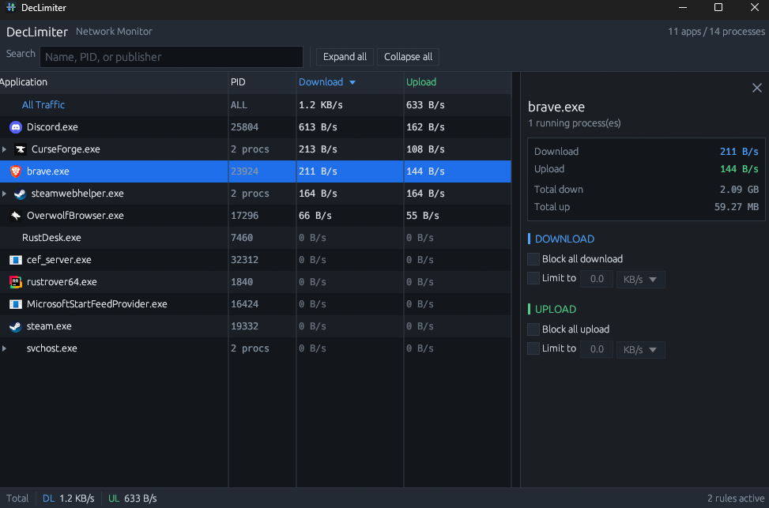

# DecLimiter
A free alternative to [NetLimiter](https://www.netlimiter.com/) on Windows.



## Installation
1. Compile DecLimiter from source or get an exe from [releases](https://github.com/dec4234/DecLimiter/releases)
```shell
git clone https://github.com/dec4234/DecLimiter

cargo build --release
```

DecLimiter uses the [Windows Packet Filter](https://github.com/wiresock/ndisapi) driver (MIT license).
If the driver is not installed, DecLimiter asks you when it starts. If you agree, it downloads the
official installer from GitHub, checks its SHA-256 hash and installs it. This needs an internet
connection. In the CLI, `--install-driver` installs the driver without the prompt.
To remove the driver, uninstall
"Windows Packet Filter x64" in Windows Settings > Apps.

## Usage
There are 2 provided ways to limit the speed of a process.

### Selection List
1. Run the .exe file as an adminstrator
2. Select a process from the list
3. Set a download speed

### CLI
```shell
-p, --pid = The process id of the process you want to control
-d, --download = Set the maximum download speed of the process (Optional)
-u, --upload = Set the maximum upload speed of the process (Optional)
-g, --garbage-collect = Set the garbage collection delay in seconds [Default: 60]
--install-driver = Install the Windows Packet Filter driver without a prompt if it is missing
```

Speeds are in bits per second, with an optional unit: `K`, `M`, `G`, `T` or `P`
(steps of 1000), and an optional `bps` suffix. For example, `-d 10Mbps` limits
the download to 10 megabits per second (1.25 MB/s). The minimum is `8` (1 byte
per second).

## Todo
- Doesn't reconnect if adapter disconnects and reconnects
- Readings still ~5% inaccurate

## Long term
- [ ] Implement a way to set different limits for different network interfaces
- [ ] Backend that works on mac and linux